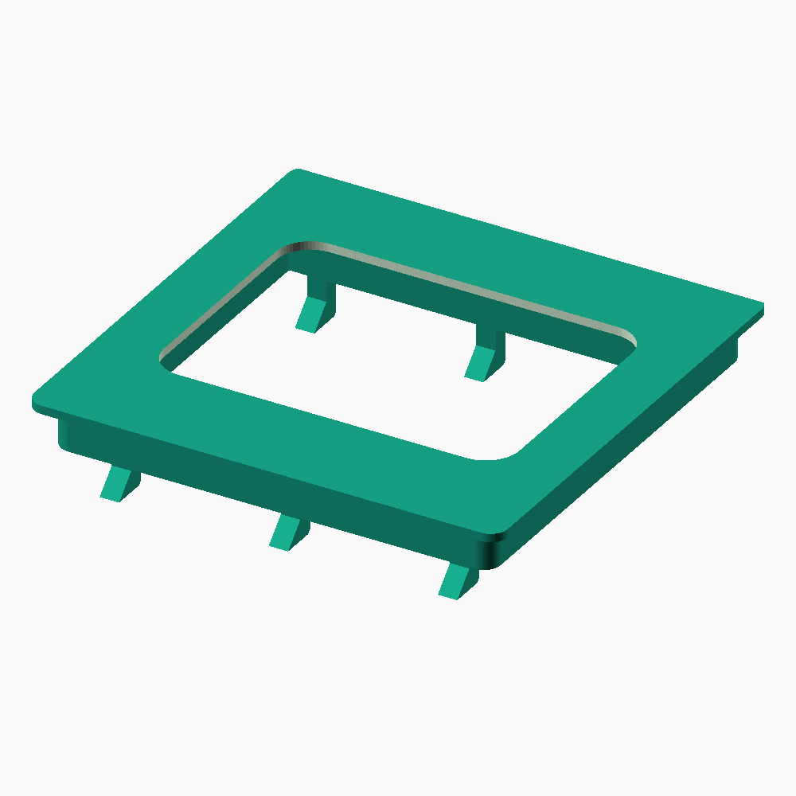
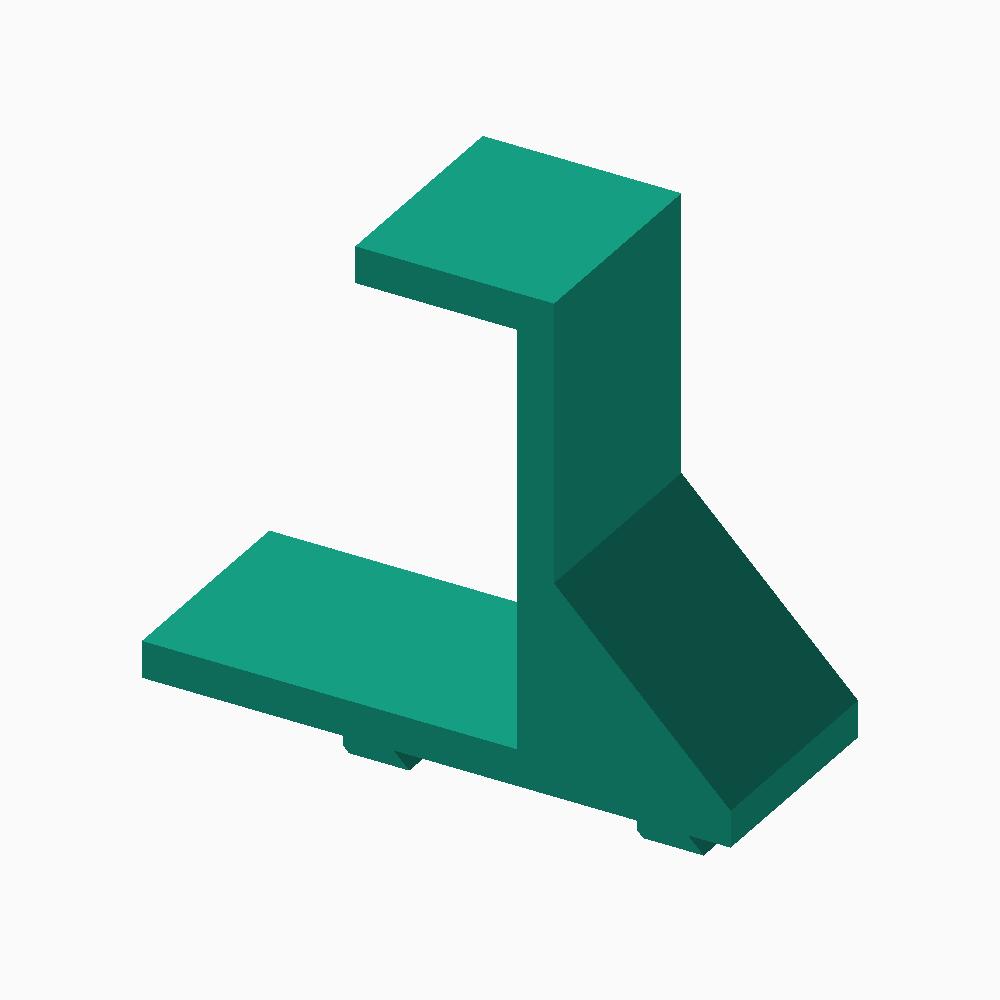

# SKÅDIS mount for the rain "the101" 5G router

**Get your the101 router off the desk and onto an IKEA SKÅDIS pegboard — no screws, no drilling, no adhesive.**

[](LICENSE)
[](https://openscad.org)

<table>
<tr>
<td width="50%"><picture><source media="(prefers-color-scheme: dark)" srcset="docs/images/bracket-dark.png"></picture></td>
<td width="50%"><picture><source media="(prefers-color-scheme: dark)" srcset="docs/images/hooks-dark.png"></picture></td>
</tr>
<tr>
<td><b>A — Bracket.</b> Slides into the router's base and vanishes behind it. Tidy, but has to match your unit. 1 part, ~28 g, ~2 h, no supports.</td>
<td><b>B — Cradle hooks.</b> The router just sits in them. Nothing to fit, so they work on any the101. 2 parts, ~19 g each.</td>
</tr>
</table>

**Not sure? Print the hooks** — they need no measuring and can't not fit. The
bracket is the nicer result if your unit matches; [checking](#will-it-fit-mine)
takes a minute.

## Quick start

**1. Grab the STL** — GitHub previews these in the browser:
[bracket](stl/101_skadis_bracket.stl) · [hooks](stl/101_skadis_hooks.stl) _(print two)_

**2. Slice it.**

|                | Bracket                                                                              | Cradle hooks                       |
| -------------- | ------------------------------------------------------------------------------------ | ---------------------------------- |
| Orientation    | Flat, plate face **down**, pegs up                                                   | On its side, 30 mm face on the bed |
| Supports       | **None**                                                                             | Tree supports, **pegs only**       |
| Layer height   | **0.2 mm** — must divide into 2.0 mm evenly, or the slicer rounds the plate off spec | 0.2 mm                             |
| Walls / infill | 3 walls, 25 %                                                                        | 3 walls, 25 %                      |

PLA is fine; PETG if the router runs warm or the board catches sun.

**3. Hang it.** Push the pegs in near the _top_ of their slots, then drop the
part ~11 mm so the barbs catch behind the board.

- **Bracket:** hang it so the router lowers **down** onto the plate, open side of
  the base facing down. Gravity holds it seated — no latch needed. To remove, lift.
- **Hooks:** space them **160 mm apart** (four slot columns).

## Will it fit mine?

Every measurement came off one specific unit with calipers, and commercially sold
"the101 brackets" advertise dimensions that don't match it — so check yours.

- **Bracket** — needs a **112 mm square well** with a **4.0 mm gap** under the
  retention tabs. Measure those two. If they differ, change `plate_sq` /
  `tongue_t` below and re-export.
- **Hooks** — need nothing measured. They only use the published body size
  (230 × 230 × 56 mm).

One number, the well's depth, was never measured and is assumed at 5.7 mm. It
only sets how far the bracket stands off the board and errs high on purpose, so
the worst case is a slightly wider air gap than necessary.

## Customising

Everything is parametric. Install [OpenSCAD](https://openscad.org), edit
[`src/skadis_101_mount.scad`](src/skadis_101_mount.scad), then:

```sh
make            # re-export both STLs
make preview    # re-render the images above
```

| Variable     | Default | Change it when                                                                                  |
| ------------ | ------- | ----------------------------------------------------------------------------------------------- |
| `tongue_t`   | 2.0     | You want a snug plate — 2.0 mm in a 4.0 mm slot lets the router rock a little; raise toward 3.8 |
| `plate_sq`   | 112.0   | Your well measures differently                                                                  |
| `tongue_fit` | 0       | The plate binds going in                                                                        |
| `peg_clear`  | 0.4     | Pegs too tight in the slots → raise; too loose → lower                                          |
| `board_t`    | 5.2     | You have the 3 mm SKÅDIS variant                                                                |
| `air_gap`    | 6.0     | You want the router closer to or further off the board                                          |

## More

The [**build guide**](docs/build-guide.md) has the whole design: what the router's
mounting interface actually is, a cross-section of the assembly, why the standoff
ribs exist, where a third of the weight went, the load numbers, and sources.

```
src/skadis_101_mount.scad    the model — every parameter is at the top
stl/                         ready-to-slice exports
docs/                        build guide, renders, section drawing
Makefile                     re-export the STLs and images
```

## Contributing

Issues and PRs welcome. The **most useful** contribution is measurements from
another the101 — rain may well have shipped more than one base moulding, and this
is built from a sample of one. Open an issue with your well width, tab slot gap,
well depth if you can reach it, and whether the stock bracket fitted. Photos of
prints in the wild are welcome too.

## License

[**CC BY-SA 4.0**](LICENSE) — print it, sell prints of it, remix it. Credit
Benny-Gil and share modified designs under the same license.
