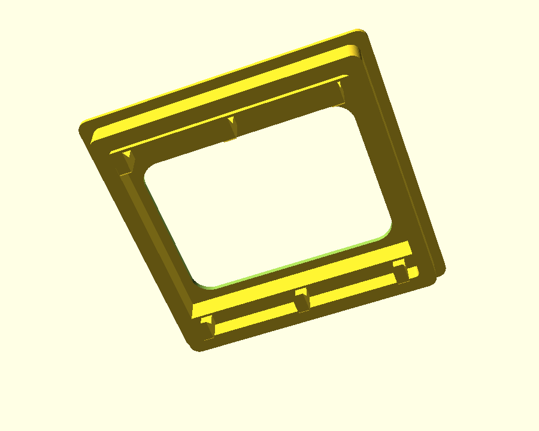
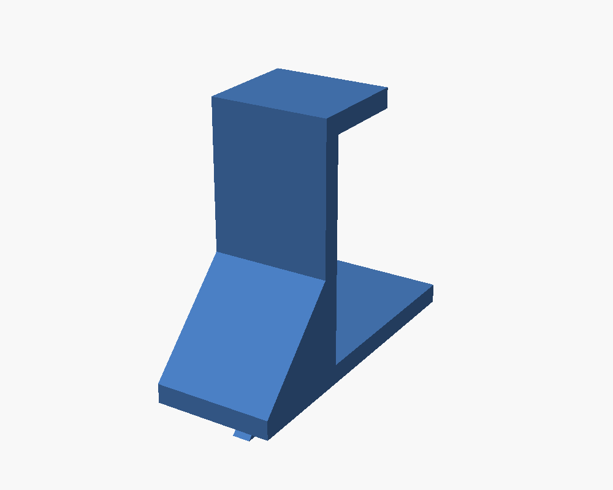

# SKÅDIS mount for the rain "the101" 5G router

Parametric OpenSCAD. One source file, two printed parts.

|                                                                                                              |                                                                                               |
| :---------------------------------------------------------------------------------------------------------------------------------------------------------- | :----------------------------------------------------------------------------------------------------------------------------------------- |
| **Bracket** — 112 × 112 × 2.0 mm plate that slides into the router's base well under its retention tabs, with six SKÅDIS pegs on the back. The real answer. | **Cradle hooks** — two L-hooks the router just sits in. Need no measurements of your unit, so they work even if the numbers below are off. |
| [`stl/101_skadis_bracket.stl`](stl/101_skadis_bracket.stl)                                                                                                  | [`stl/101_skadis_hooks.stl`](stl/101_skadis_hooks.stl)                                                                                     |

📖 **[Full build guide](docs/build-guide.md)** — the research behind the mount, a
cross-section drawing, and the load numbers.

## Mounting it

the101 has no screw bosses. Its underside is a shallow square **well** ringed by
moulded plastic **retention tabs**, and a flat plate slides in sideways and is
captured under them.

**Hang the bracket so the router lowers DOWN onto the plate** — the well's open
side facing down once the router is up. Gravity holds it seated, so no latch is
needed. To remove, lift.

For the hooks: print two and space them **160 mm apart** (four slot columns).

## Printing

|               | Bracket                             | Hooks (×2)                         |
| ------------- | ----------------------------------- | ---------------------------------- |
| Orientation   | Face down, ribs and pegs up         | On its side, 30 mm face on the bed |
| Supports      | **None** — peg barbs are ramped 45° | Tree supports on the pegs only     |
| Layer height  | **0.2 mm** — must divide `tongue_t` | 0.2 mm                             |
| Settings      | 3 walls, 25 % infill                | 3 walls, 25 % infill               |
| Weight / time | ~28 g, ~2 h                         | ~19 g each                         |

PETG over PLA if the router runs warm or the board catches sun.

> **Fit note.** The 2.0 mm plate sits in a 4.0 mm tab slot, so it has ~2 mm of
> slop and the router can rock slightly. That is the cost of the thin plate, not
> a bug — raise `tongue_t` toward 3.8 for a snug fit.

## Key dimensions

Every interface number was measured off this unit. Commercially sold "the101
brackets" advertise dimensions that don't match it, so none of their specs are
used here.

|              |                                         |                        |
| ------------ | --------------------------------------- | ---------------------- |
| Tab slot gap | 4.0 mm                                  | measured               |
| Tab width    | 12 mm                                   | measured               |
| Well width   | 112 mm                                  | measured               |
| Router body  | 230 × 230 × 56 mm                       | rain.co.za             |
| Well depth   | 5.7 mm                                  | **assumed, errs high** |
| SKÅDIS slots | 5.0 × 15.0 mm, 40 mm grid, 5.2 mm board |                        |

`well_depth` is the one number nobody measured. It only feeds the standoff:
over-estimating just widens the air gap, while under-estimating means the ribs
foul the router's rim and the plate never seats — so it errs high on purpose.

The back of the plate carries a 104 mm perimeter ring and two cross ribs standing
it **9.7 mm** off the board (pegs run 20.3 mm to reach through). That isn't
decoration — mounted vertically, the router's vented underside would otherwise
sit flat against fibreboard. The ribs buy a 6 mm air gap and the 2.0 mm plate
leans on them for most of its stiffness.

## Building

```sh
make            # re-export both STLs
make preview    # re-render the images above
```

Every dimension is a variable at the top of [`src/skadis_101_mount.scad`](src/skadis_101_mount.scad).
The ones you're most likely to touch:

| Variable     | Default | Change it when                                 |
| ------------ | ------- | ---------------------------------------------- |
| `tongue_t`   | 2.0     | You want a snug plate instead of the thin one  |
| `plate_sq`   | 112.0   | Your well measures differently                 |
| `tongue_fit` | 0       | The plate binds sliding in                     |
| `peg_clear`  | 0.4     | Pegs bind → raise. Sloppy → lower.             |
| `board_t`    | 5.2     | You have the 3 mm SKÅDIS variant               |
| `air_gap`    | 6.0     | You want it closer to or further off the board |
| `lighten`    | true    | Set false for a solid plate, no centre window  |

`tongue_t` also drives the standoff — the ribs must clear however far the
router's rim hangs past the plate, so a thinner plate means taller ribs and
longer pegs.

## Layout

```
src/skadis_101_mount.scad    the model, all parameters at the top
stl/                         ready-to-slice exports
docs/build-guide.md          long-form build guide
docs/images/                 renders and the section drawing
Makefile                     re-export the STLs and images
```

## Sources

- [rain — the101](https://www.rain.co.za/the101) — 230 × 230 × 56 mm
- [TechCentral — rain unveils 'the101'](https://techcentral.co.za/rain-the101-5g-smart-router-raipr/234417/) — platform details
- [Parametric SKÅDIS Board Generator](https://www.printables.com/model/206256-parametric-skadis-board-generator) — 5 mm nominal slot width
- [IKEA SKÅDIS Add-Ons](https://makerworld.com/en/models/799571-ikea-skadis-add-ons-parametric-bins-and-shelves) — published hook geometry

The mounting interface came from measuring the unit, not from any of these.
