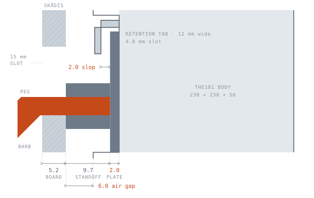
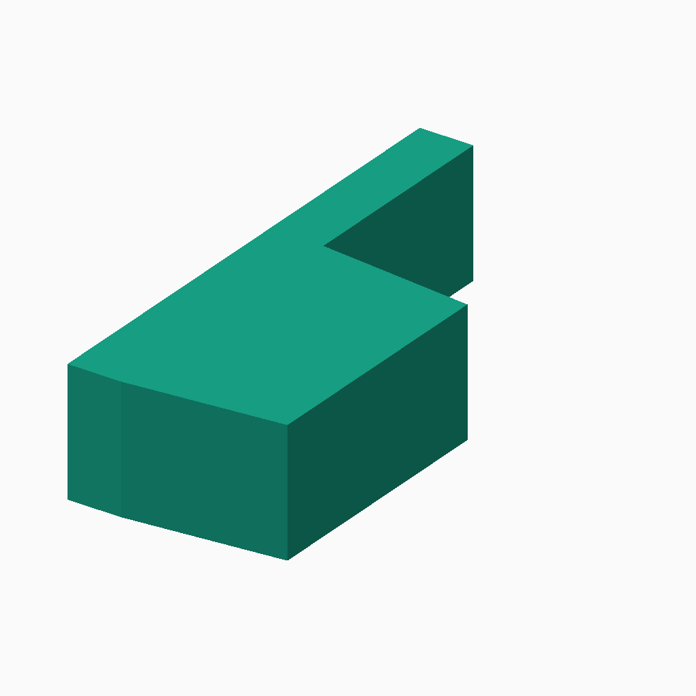
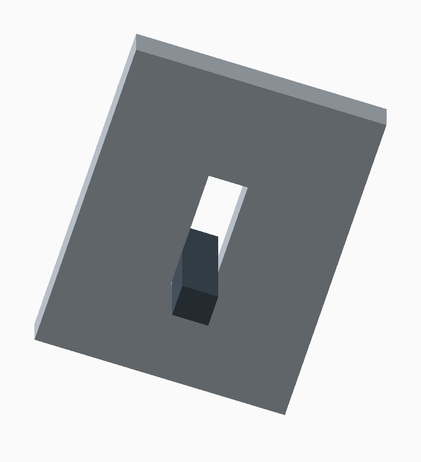
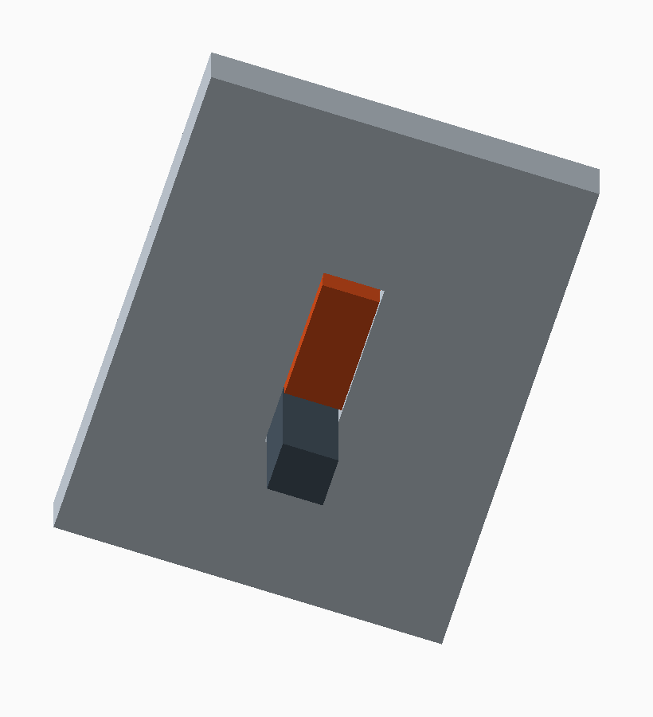

# the101 Pegboard Mount — build guide

> rain's the101 router doesn't take screws. Its underside hides a slide-in
> captive plate — so the SKÅDIS part is a rebuild of that plate, with pegs where
> the wall screws went.

| Mount type     | Tab slot | Plate        | Body        | SKÅDIS pitch |
| -------------- | -------- | ------------ | ----------- | ------------ |
| Slide-in plate | 4.0 mm   | 112 × 2.0 mm | 230 × 56 mm | 40 mm        |

## What the mount actually is

The part that had to be researched before anything could be drawn.

the101 is a 230 × 230 × 56 mm rounded-square 5G CPE. Its underside has a shallow
square **well** ringed by moulded plastic **retention tabs**. A flat plate slides
in sideways and is captured under those tabs.

There are no screw bosses in the router. The tabs are the whole interface: a
4.0 mm slot, 12 mm wide at each tab, around a 112 mm well.

Every one of those came off this unit with calipers. Commercially sold "the101
brackets" advertise dimensions that don't match it, so none of their specs are
used here — worth knowing if you go looking, because their numbers point at a
plate that won't fit.

One number is still unmeasured: the **well depth**, floor down to the router's
outer rim. It only feeds the standoff. Over-estimating is safe — it just widens
the air gap — while under-estimating means the ribs foul the rim and the plate
never seats. So `well_depth` errs high at 5.7 mm on purpose; measure your own and
you can tighten it.



_Section through the stack. The peg threads the 5 × 15 mm slot and drops so its
barb sits behind the board; the standoff rib holds the router's vented underside
6 mm clear of the fibreboard; the tab captures the plate's edge, leaving 2.0 mm
of play in the 4.0 mm slot._

## Interface numbers

Everything the model is built from, and where each figure came from.

| Dimension        | Value                  | Source              |
| ---------------- | ---------------------- | ------------------- |
| Tab slot gap     | 4.0 mm                 | Measured            |
| Tab width        | 12 mm                  | Measured            |
| Well width       | 112 mm                 | Measured            |
| Well depth       | 5.7 mm                 | Assumed, errs high  |
| **Build target** | **112 × 112 × 2.0 mm** | This plate          |
| Router body      | 230 × 230 × 56 mm      | rain.co.za          |
| SKÅDIS slot      | 5.0 × 15.0 mm          | Community reference |
| SKÅDIS grid      | 40 mm, square          | 560 mm board ÷ 14   |
| SKÅDIS thickness | 5.2 mm                 | Community reference |

## Hang it upside down

> **The one thing to get right.**
>
> A slide-in plate needs something to stop it sliding back out. The usual answer
> is a detent. The better answer is orientation: mount the bracket so the router
> is lowered **down** onto the plate, with the well's open side facing down once
> it's up.
>
> Gravity then holds the plate seated and no latch is needed at all. To remove
> the router, lift it.

## Three parts

One source file, `src/skadis_101_mount.scad`, switched by the `part` variable.

### Bracket — `stl/101_skadis_bracket.stl`

<picture><source media="(prefers-color-scheme: dark)" srcset="images/bracket-dark.png"></picture>

A 112 × 112 × 2.0 mm plate that slides into the well under the tabs, with six
SKÅDIS pegs on the back. This is the real answer.

**Fit note.** 2.0 mm sits in a 4.0 mm tab slot, so the plate has ~2.0 mm of slop
and the router can rock on it slightly. That is the cost of the thin plate, not a
bug — raise `tongue_t` toward 3.8 for a snug fit.

The back carries a perimeter ring and two cross ribs that stand it 9.7 mm off the
board — a 104 mm ring inside a 4 mm bare lip, with the cross ribs inboard of it
carrying the pegs. That isn't decoration: mounted vertically, the router's vented
underside would otherwise sit flat against fibreboard. The ribs buy a 6 mm air
gap and, at 2.0 mm, the plate leans on them for most of its stiffness. The pegs
run 20.3 mm to reach through.

It's deliberately one flat plate rather than a stepped plate with an oversailing
slab: a step would leave an unsupported ledge on the bed.

Keep the layer height a divisor of the plate thickness. At 2.0 mm that means
0.2 mm — ten clean layers. 0.28 mm gives 7.1 and the slicer rounds the plate off
spec.

> **Face down, pegs up · no supports** · 3 walls · 25 % · **0.2 mm** · ~28 g ·
> ~2 h · PETG if it runs warm

### Cradle hooks — `stl/101_skadis_hooks.stl`, print 2

<picture><source media="(prefers-color-scheme: dark)" srcset="images/hooks-dark.png"></picture>

Two L-hooks the router simply sits in. These need **no** measurements of your
unit's well, so they work even if the numbers above turn out to be off. Space
them 160 mm apart — four slot columns.

The 62 mm shelf swallows the full 56 mm body depth and the 22 mm lip stops it
tipping out. Two pegs 40 mm apart per hook; one peg alone would let the hook
swing.

> **On its side** · tree supports, pegs only · ~19 g each · 160 mm apart

### Locking wedge — `stl/101_skadis_wedge.stl`

<picture><source media="(prefers-color-scheme: dark)" srcset="images/wedge-dark.png"></picture>

A hung peg rests its neck on the slot's bottom edge, so it fills only 4 mm of
the 15 mm slot. The 11 mm above it is the lift travel: raise the bracket by
that much and the barb clears the slot. Because the router is removed by
lifting it off the plate, the bracket can come away with it.

This blade fills the gap. One wedge stops the lift; a second one, diagonally
opposite, also stops the bracket twisting on its pegs.

| Without the wedge                              | With the wedge                                |
| :--------------------------------------------- | :-------------------------------------------- |
|  |  |

**It enters from behind the panel.** The perimeter ring encircles all six pegs,
so a head on the front face has no route out past the ring for a finger.
Behind the board the space above the peg is clear, because the barb hangs
below it. The head is taller than the gap the blade fills, so it cannot follow
the blade through, and it doubles as the grip.

The blade narrows by `wedge_taper` toward its tip, so it leads in easily and
jams at the end. Raise `wedge_clear` if it binds in the slot, and `wedge_fit`
if it will not enter.

> **Print it flat as it comes out of the file.** No overhangs and no supports.
> A pair takes a couple of minutes.

## Where the weight went

74.2 → 49.6 cm³, ~41 → ~28 g. A third off, at no meaningful cost.

The ribs were three quarters of the part, so that is where the mass was. Two
changes did it.

**Narrower ribs, 10 → 6 mm.** A rib's bending stiffness goes as its _height_
cubed and only linearly with width. The 9.7 mm standoff was always doing the
work — 10 mm of width was mass. This drops rib second moment to 60 % of before,
against margins that were already ~40×, and 6 mm still leaves 1 mm either side of
a peg neck.

**A window through the plate's dead centre.** The tabs grip the perimeter and the
load runs perimeter → ring → cross ribs → pegs, all of it outside the 84 × 62 mm
cutout. Nothing structural passed through that area. It vents the well as a
bonus. Set `lighten = false` for the solid plate back.

For more, go after the slicer rather than the model — 2 walls and 15 % infill
takes a few more grams. The ribs are only 6 mm wide now, so most of their volume
is perimeter either way; the geometry is what saved this.

## Tuning

Every dimension is a variable at the top of the `.scad` file.

| Variable     | Default | Change it when                                         |
| ------------ | ------- | ------------------------------------------------------ |
| `tongue_t`   | 2.0     | You want a snug plate instead of the thin one          |
| `plate_sq`   | 112.0   | Your well measures differently                         |
| `tongue_fit` | 0       | The plate binds sliding in                             |
| `peg_clear`  | 0.4     | Pegs bind → raise. Sloppy → lower.                     |
| `board_t`    | 5.2     | Your board is not a genuine IKEA one — see below       |
| `air_gap`    | 6.0     | You want it closer to or further off the board         |
| `rib_in`     | 4.0     | Wider or narrower lip; also sets the ring's outer size |
| `rib_w`      | 6.0     | Below ~5 there's no margin either side of a peg        |
| `lighten`    | true    | You want the solid plate back, no centre window        |

```sh
make            # re-export all four STLs into stl/
make preview    # re-render the images

# or, directly:
openscad -o stl/101_skadis_bracket.stl -D 'part="bracket"' src/skadis_101_mount.scad
openscad -o stl/101_skadis_hooks.stl   -D 'part="hooks"'   src/skadis_101_mount.scad
```

### Printed SKÅDIS panels

A printed SKÅDIS panel copies the slot and the grid exactly, but not the
thickness. The panels measured for this project are **3.0 mm**, against
5.2 mm for an IKEA board. The peg barb then closes 2.2 mm too far out and
grips nothing, so the part hangs loose.

`board_t` is the only variable that has to change, and `stl/*_3mm.stl` holds
the result. The peg drops from 20.3 mm to 18.1 mm of protrusion; the plate,
the ribs and the standoff do not move.

Measured on a LabRax SKÅDIS rack panel, 1U to 10U:

|                         | LabRax panel             | IKEA SKÅDIS              |
| ----------------------- | ------------------------ | ------------------------ |
| Thickness               | **3.00 mm**              | 5.2 mm                   |
| Slot                    | 5.00 × 15.00 mm          | 5.0 × 15.0 mm            |
| Slot pitch, along a row | 20 mm                    | 20 mm                    |
| Row pitch               | 10 mm, rows offset 10 mm | 10 mm, rows offset 10 mm |

The grid is staggered, not square: a row holds a slot every 20 mm, and the
next row sits 10 mm up and 10 mm across. A 40 mm step therefore lands on a
slot on both axes, which is what the six pegs assume. All 170 slots on the
5U panel have a neighbour 40 mm away in X and in Y.

### Will it hold?

A ~1 kg router on six pegs sits well inside both the pegs and a 5 mm SKÅDIS
panel. Worst case after lightweighting:

| Load path                | Stress    | Against       |
| ------------------------ | --------- | ------------- |
| Peg neck bending         | 1.3 MPa   | ~50 MPa yield |
| 4 mm lip at a tab        | 0.6 MPa   | ~50 MPa yield |
| Rib bearing on the board | 0.003 MPa | over 3600 mm² |

The perimeter ring bearing flat on the board is what actually takes the tipping
moment — the pegs mostly just stop it falling off.

## Sources

- [rain — the101](https://www.rain.co.za/the101) — 230 × 230 × 56 mm
- [TechCentral — rain unveils 'the101'](https://techcentral.co.za/rain-the101-5g-smart-router-raipr/234417/) — platform & hardware
- [Parametric SKÅDIS Board Generator](https://www.printables.com/model/206256-parametric-skadis-board-generator) — 5 mm nominal slot width
- [IKEA SKÅDIS Add-Ons](https://makerworld.com/en/models/799571-ikea-skadis-add-ons-parametric-bins-and-shelves) — published hook geometry

Parametric OpenSCAD · both parts verified manifold ·
[CC BY-SA 4.0](../LICENSE)
